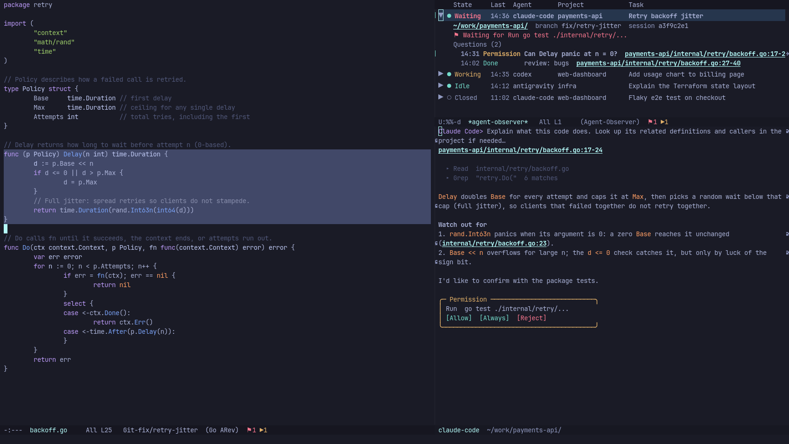

# agent-shell-observer

Watch every coding agent of
[agent-shell](https://github.com/xenodium/agent-shell) from one place in Emacs.



Every agent session shows up in one list on the right of the frame. Each row
shows:

- what the session is doing: working, waiting for you, idle, or closed
- when it last did something
- which agent it is and which project it works in
- its name: what it is working on, or a name you give it

Open a row to see where it works, its branch, and what it is waiting for. The
conversation shows below the list.

## Features

- **One list for every session.** `agent-shell-observer-toggle` shows or hides
  the list and the conversation beside it. Press `L` in the list to put the
  conversation below the list, above it, to its right, or to its left.
- **Notifications.** While the list is closed, the mode line counts the shells
  waiting for you (⚑) and the ones working (▶). A desktop notification tells
  you when a shell asks for a permission, finishes, or fails, unless you are
  already looking at it.
- **Names.** A session is named after what it is working on (the agent's
  title, a title written for its first prompt, or that prompt), or after its
  agent and project until it has one. Press `r` to give it a name of your own.
- **History.** Prompts, their agent sessions and the names you gave are saved,
  so you can bring a conversation back after restarting Emacs.
- **Prompts from your own commands.** `agent-shell-observer-submit` sends a
  prompt to a shell and follows it in the list, so a command of your own (for
  example, one that asks about the code at point) gets the same tracking.
- **Readable input.** Markdown in your own messages is rendered the same way
  agent-shell renders the agent's replies.

## Requirements

- Emacs 29.1 or later
- [agent-shell](https://github.com/xenodium/agent-shell) 0.91.1 or later, with
  at least one agent set up (Claude Code, Codex, Antigravity, opencode, …)
- Optional: [Ollama](https://ollama.com) running locally, to write short titles
  for prompts (see `agent-shell-observer-summarize-titles`)

## Installation

With `use-package` and Emacs 30 or later:

```elisp
(use-package agent-shell-observer
  :vc (:url "https://github.com/witnessJo/agent-shell-observer" :rev :newest)
  :commands agent-shell-observer-toggle
  :autoload agent-shell-observer-watch-shell
  :init
  ;; Track every agent shell from the moment it starts.
  (add-hook 'agent-shell-mode-hook #'agent-shell-observer-watch-shell)
  :bind ("C-c a h" . agent-shell-observer-toggle))
```

Or clone the repository and use `:load-path` instead of `:vc`.

## Commands

| Command | What it does |
|---|---|
| `agent-shell-observer-toggle` | Show or hide the session list and the conversation |
| `agent-shell-observer-watch-shell` | Follow the current agent shell; for `agent-shell-mode-hook` |

### In the list

| Key | What it does |
|---|---|
| `TAB` / click the arrow | Expand or collapse a session |
| `RET` / double click | Open the conversation below the list |
| `f` | Show all sessions, only those waiting for you, or only those working |
| `/` | Filter by agent, project, branch or state |
| `L` | Put the conversation below, above, to the right of, or to the left of the list |
| `r` | Name the session; an empty name gives back its default one |
| `D` | Remove a closed session from the list (the agent keeps its sessions) |
| `g` | Refresh |
| `q` | Hide the list and the conversation |

## Options

| Variable | Default | |
|---|---|---|
| `agent-shell-observer-layout` | `below` | Where the conversation goes: `below`, `above`, `right` or `left` of the list |
| `agent-shell-observer-history-file` | `agent-shell-observer-history.eld` in `user-emacs-directory` | Where prompts are saved; `nil` turns saving off |
| `agent-shell-observer-notify-states` | `(waiting done error)` | Which states send a desktop notification |
| `agent-shell-observer-summarize-titles` | `t` | Have a local Ollama model name sessions from their first prompt |

## Sending prompts from your own commands

```elisp
(agent-shell-observer-submit shell-buffer prompt
                             :title "Why does this fail?"
                             :location "src/foo.el:42")
```

The prompt goes to `shell-buffer`, whose session moves to the top of the list
and opens below it. `:title` names the session until a title is written for it,
and `:location` is the place the prompt is about, as the prompt names it: the
conversation is scrolled there when the session is opened.

| Hook | |
|---|---|
| `agent-shell-observer-failed-functions` | Called with the entry, the agent and the reason when a prompt fails or its shell never starts a session. Return non-nil after sending the entry elsewhere with `agent-shell-observer-resubmit`; otherwise the prompt is marked failed and a message says why. |
| `agent-shell-observer-title-text-function` | Returns the text a session's title is written from, for example the prompt without text every prompt adds. |
| `agent-shell-observer-owned-functions` | Marks a shell as driven by something else, so its prompts don't become sessions of their own. |

## Tests

```sh
emacs -Q --batch -l test/agent-shell-observer-test.el -f ert-run-tests-batch-and-exit
```
